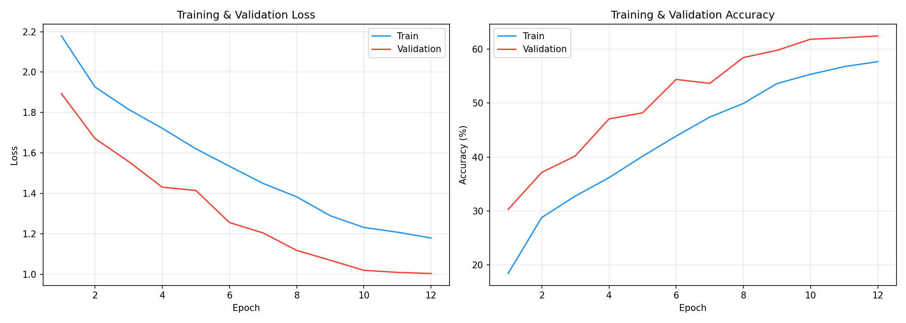
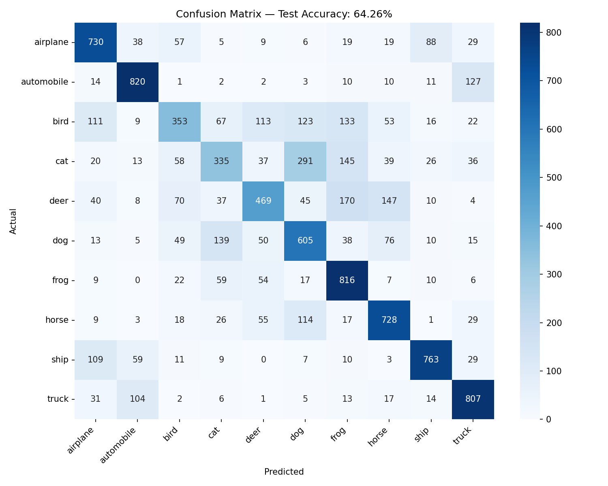
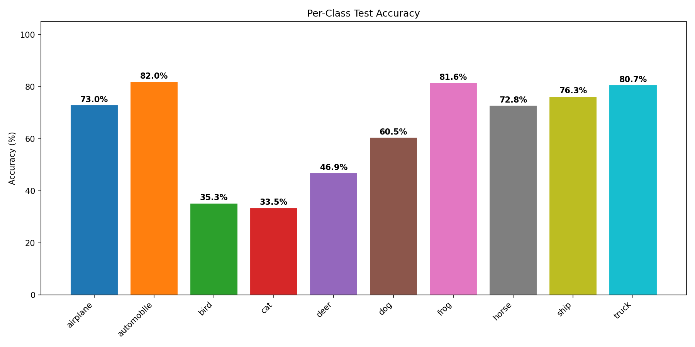
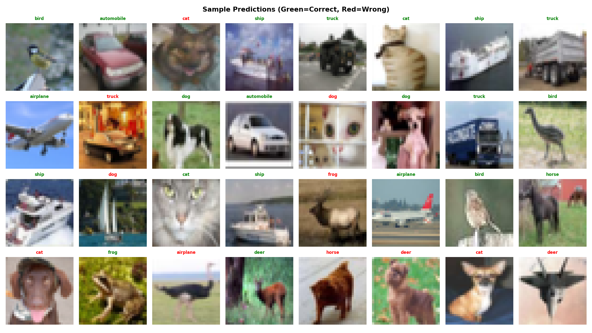
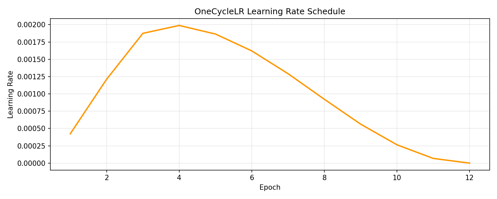

# CNN Image Classification with PyTorch

Sixty-four percent on CIFAR-10 does not sound impressive until you look at the budget: a from-scratch CNN, no pre-trained weights, 15,000 of the 50,000 training images, twelve epochs, and a laptop GPU from 2019. This project is about learning how far careful architecture design and training hygiene — batch normalization, dropout, augmentation, OneCycleLR — can take you under those constraints. The full-data, 50-epoch script is included for anyone with a bigger GPU budget.


> **Experiment record:** The reported 64.26% test accuracy is from the tracked 15K-sample, 12-epoch reference run. Its metrics, plots, hyperparameters, and classification report are versioned; the model checkpoint is deliberately not tracked because it is a generated binary artifact.

## Project Overview

| Component | Details |
|-----------|---------|
| **Dataset** | CIFAR-10 (60,000 32x32 color images, 10 classes) |
| **Architecture** | Custom 3-block CNN with Batch Normalization |
| **Parameters** | 815,018 trainable |
| **Framework** | PyTorch |
| **Test Accuracy** | **64.26%** |
| **Training Time** | ~17 minutes on NVIDIA MX330 GPU |

## Architecture

```
Input (3x32x32)
    |
Conv Block 1: [Conv3x3(3->32) -> BN -> ReLU] x2 -> MaxPool -> Dropout(0.25)
    |   Output: 32x16x16
Conv Block 2: [Conv3x3(32->64) -> BN -> ReLU] x2 -> MaxPool -> Dropout(0.25)
    |   Output: 64x8x8
Conv Block 3: [Conv3x3(64->128) -> BN -> ReLU] x2 -> MaxPool -> Dropout(0.25)
    |   Output: 128x4x4
Flatten -> FC(2048->256) -> ReLU -> Dropout(0.5) -> FC(256->10)
    |
Output (10 classes)
```

### Key Design Choices
- **Batch Normalization** after every convolution for stable training
- **Dropout** (0.25 in conv blocks, 0.5 in classifier) for regularization
- **Progressive channel widening** (32 -> 64 -> 128) to capture increasingly abstract features
- **Data augmentation** (random crop, horizontal flip, color jitter) to prevent overfitting

## Results

### Training Curves


### Confusion Matrix


### Per-Class Accuracy


| Class | Accuracy |
|-------|----------|
| Airplane | 73.0% |
| Automobile | 82.0% |
| Bird | 35.3% |
| Cat | 33.5% |
| Deer | 46.9% |
| Dog | 60.5% |
| Frog | 81.6% |
| Horse | 72.8% |
| Ship | 76.3% |
| Truck | 80.7% |

### Sample Predictions


### Learning Rate Schedule


## Hyperparameters

| Parameter | Value |
|-----------|-------|
| Optimizer | Adam (weight_decay=1e-4) |
| LR Scheduler | OneCycleLR (max_lr=0.002) |
| Batch Size | 128 |
| Epochs | 12 |
| Dropout | 0.25 (conv), 0.5 (FC) |
| Augmentation | RandomCrop, HFlip, ColorJitter |

## Project Structure

```
CNN-Image-Classification-PyTorch/
|-- src/
|   |-- model.py              # CNN architecture definition
|   |-- train.py               # Full training pipeline (50 epochs, CosineAnnealing)
|   |-- train_fast.py          # Quick training script (12 epochs, OneCycleLR)
|-- results/
|   |-- figures/
|   |   |-- 01_training_curves.png
|   |   |-- 02_confusion_matrix.png
|   |   |-- 03_per_class_accuracy.png
|   |   |-- 04_sample_predictions.png
|   |   |-- 05_learning_rate.png
|   |-- test_results.json      # Quantitative metrics
|   |-- classification_report.txt
|   |-- hyperparameters.json
|   |-- training_history.json
|-- docs/diagrams/             # SVG architecture diagram
|-- requirements.txt
|-- README.md
```

## Getting Started

### Prerequisites

```bash
pip install -r requirements.txt
```

### Training

**Quick training** (~17 min on GPU):
```bash
cd src
python train_fast.py
```

**Full training** (~2 hours on GPU, higher accuracy):
```bash
cd src
python train.py
```

CIFAR-10 is automatically downloaded on first run.

## Reproducibility Check

```bash
python scripts/check_repository.py
```

This check verifies the source and reference-result artifacts without downloading CIFAR-10 or running training.

### Extending the Model

To improve accuracy beyond 64%, consider:
- **More epochs**: Training for 50+ epochs with CosineAnnealing scheduler (`train.py`)
- **Full dataset**: Using all 50,000 training samples
- **Architecture**: Adding residual connections (ResNet-style)
- **Advanced augmentation**: Cutout, Mixup, or CutMix

## Technical Stack

- **PyTorch** 2.x — Model definition and training
- **torchvision** — CIFAR-10 dataset, transforms, augmentation
- **scikit-learn** — Confusion matrix, classification report
- **matplotlib / seaborn** — Publication-quality visualizations
- **NumPy** — Numerical operations

## Notes

- Results shown are from training on a subset (15K samples, 12 epochs) for efficiency on a laptop GPU (NVIDIA MX330)
- The `train.py` script supports full 50-epoch training on the complete dataset for higher accuracy (~85%+)
- The custom architecture achieves competitive results without relying on pre-trained models or transfer learning

## Author

**Mohd Zamin Quadri**
- GitHub: [@mzquadri](https://github.com/mzquadri)
- M.Sc. Computational Mechanics, Technical University of Munich (TUM)

## License

This project is licensed under the MIT License. See [LICENSE](LICENSE).
