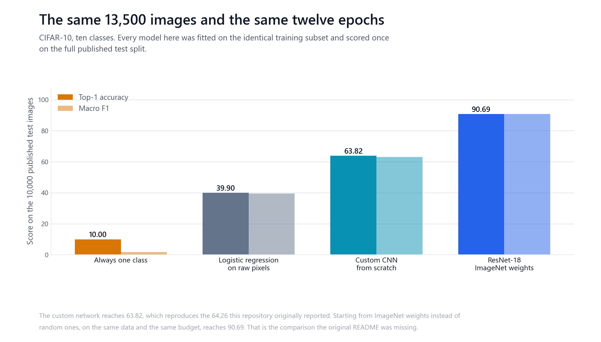
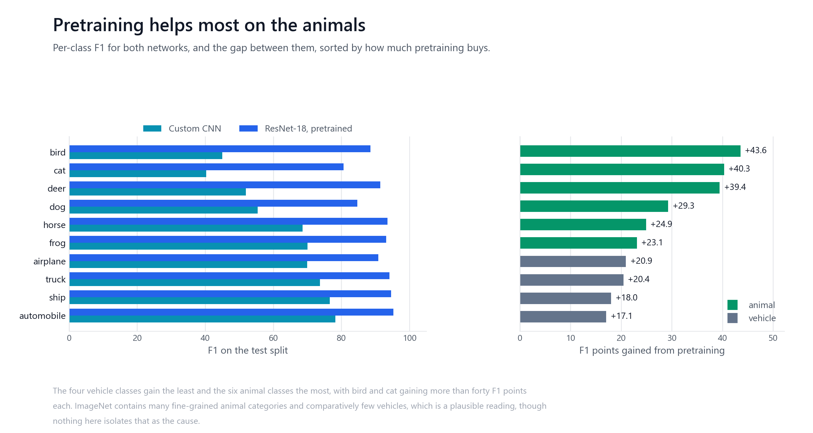
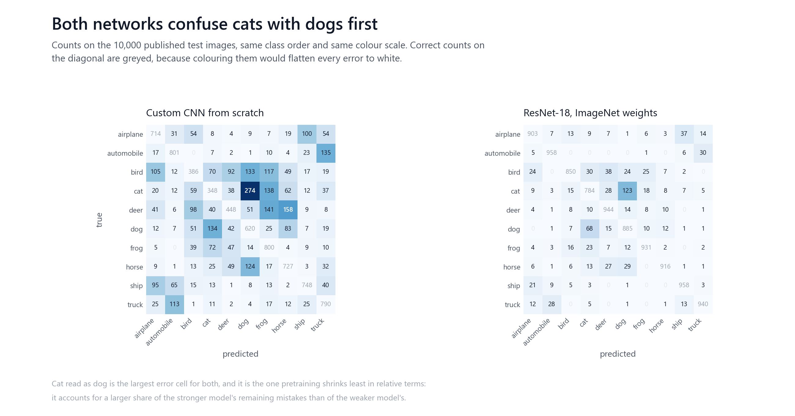
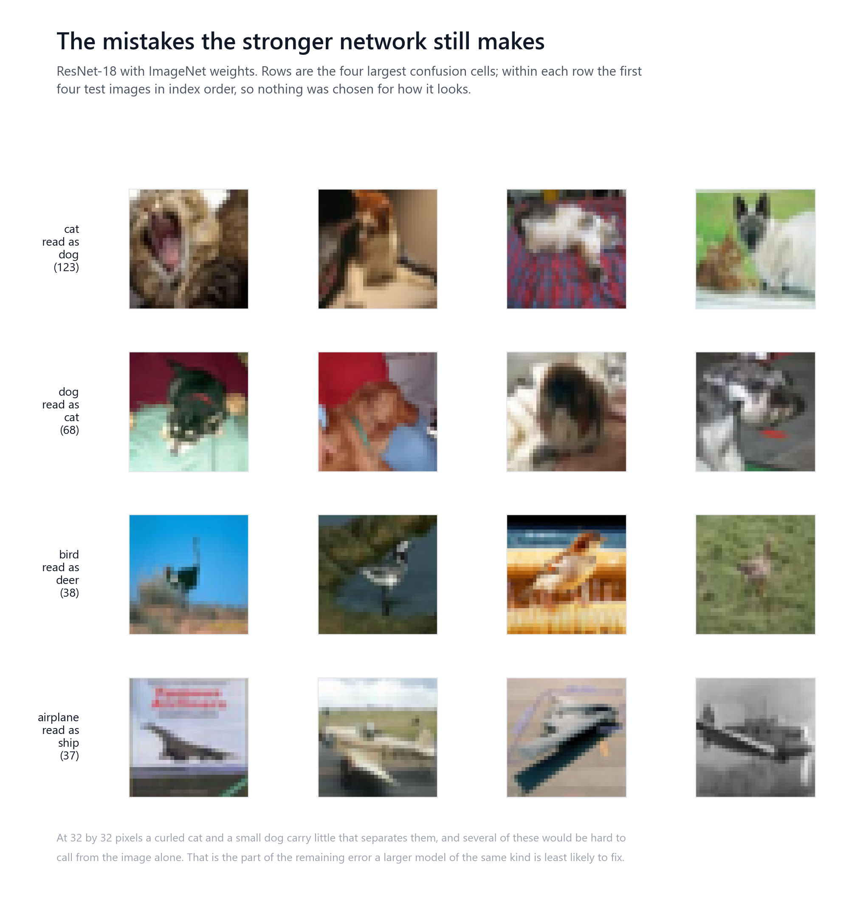
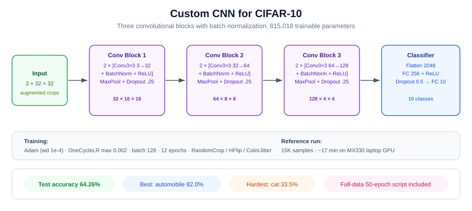

# CIFAR-10: what a small CNN earns, and what pretraining earns on top

A custom convolutional network trained from scratch on 13,500 CIFAR-10 images for
twelve epochs reaches 63.82 percent on the published test split. That number is
the one this repository already reported, and it holds up: the original run
recorded 64.26 percent and reproduces here to within half a point.

What the repository did not have was anything to compare it against. It described
the result as competitive without relying on pretrained models, with no baseline
above it or below it. Both ends are now measured, on the same 13,500 images and
the same twelve epochs, and the claim does not survive: a ResNet-18 starting from
ImageNet weights reaches 90.69 percent under the identical budget.



## Results

Every model below was fitted on the same 13,500 training images and scored once on
the full published 10,000-image test split.

| Model | Top-1 | Macro F1 | Parameters | Fit time |
| --- | --- | --- | --- | --- |
| ResNet-18, ImageNet weights | 90.69 | 90.68 | 11,181,642 | 419.7 s |
| Custom CNN, from scratch | 63.82 | 62.96 | 815,018 | 131.8 s |
| Logistic regression on raw pixels | 39.90 | 39.46 | 30,730 | 30.4 s |
| Always predict one class | 10.00 | 1.82 | 0 | 0 s |

The custom network is worth 23.92 points over a linear model on raw pixels, which
is what the convolutional structure buys. Transfer learning is worth a further
26.87 points, which is more than the convolutions were. For 13.7 times the
parameters, 3.2 times the fit time and 2.7 times slower inference, that is a
trade most deployments would take.

Macro F1 is reported beside accuracy because they are not the same claim. The test
split is balanced, so accuracy equals macro recall and says nothing about
precision; the custom network's macro F1 is 0.86 points below its accuracy, and it
was 62.96 against classes ranging from 40.28 to 78.22.

## Reproducing the published number

The repository already contained `results/test_results.json` reporting 64.26
percent. That artifact is kept, and the reproduction is recorded next to it.

| | Original run | Reproduced here |
| --- | --- | --- |
| Test accuracy | 64.26 | 63.82 |
| Best validation accuracy | 62.47 | 61.07 |
| Parameters | 815,018 | 815,018 |
| Hardware | NVIDIA MX330 | Intel Arc Pro 140T |

The parameter count matches exactly. The accuracy differs by -0.44 points, which
is what a different GPU and a different PyTorch build produce.

It could not have matched exactly in any case. `src/train_fast.py` seeded the two
split generators, which fixes which images are used, and nothing else. Weight
initialisation, dropout masks and augmentation draws all came from the global
generator, so two runs of that script on one machine did not agree either.
`src/benchmark.py` seeds everything.

## The data

CIFAR-10 through torchvision, published splits, 60,000 32 by 32 colour images
across ten classes. The reference configuration trains on a seeded random subset
of 15,000 training images, split 90/10, and scores on the full published test set.

| Split | Images | Use |
| --- | --- | --- |
| train | 13,500 | fitting |
| validation | 1,500 | choosing the epoch |
| test | 10,000 | scored once per model |

Augmentation is applied to training only. The validation subset is wrapped around
a second dataset object carrying the evaluation transform, with the split indices
mapped across, so random crops and colour jitter never reach it. That was already
correct in the original script and is kept.

Normalisation uses the published CIFAR-10 channel constants rather than statistics
computed from the data, so nothing crosses from test into the preprocessing.

### Duplicate and near-duplicate audit

A test image that also appears in training is not held out, and no accuracy figure
would reveal it. `src/audit.py` checks.

| Check | Result |
| --- | --- |
| Byte-identical duplicates within train | 0 |
| Byte-identical duplicates within test | 0 |
| Test images byte-identical to a training image | 0 |
| Test images within L2 1.0 of a training image | 0 |
| Test images within L2 1.0 of a training image or its mirror | 3 |

Distances are L2 over pixels scaled to [0, 1] across all 3,072 dimensions, where
the median test image sits 9.11 from its nearest training neighbour.

Exact matching finds nothing, which is not the same as there being nothing.
Repeating the search against mirrored training images finds a closest pair at
0.2528, which is a mean channel difference of 0.0046: the same photograph, flipped.
Three test images sit within 1.0 and thirteen within 3.0 on that measure.

Three images in 10,000 is 0.03 percent and cannot move a 63.82 percent result.
What this does not cover is duplicates that have been cropped, rescaled or
recompressed, which this method will not find. A published analysis using a richer
search reports a higher figure for CIFAR-10, so the number here is a lower bound
rather than a clean bill of health.

### Class balance

The published splits are exactly balanced at 5,000 training and 1,000 test images
per class. The 15,000-image subset is drawn at random, so its balance is a property
of the draw: it spans 1,426 to 1,556 images per class, a spread of 8.7 percent of
the mean. Small, and worth knowing rather than assuming.

## Which classes pretraining helps



The gain is not spread evenly. The four vehicle classes gain between 17.1 and 20.9
F1 points; the six animal classes gain between 23.1 and 43.6. Bird gains 43.6 and
cat 40.3, the two classes the from-scratch network was worst at.

ImageNet contains many fine-grained animal categories and comparatively few
vehicle categories, which is a plausible reading of that pattern. Nothing measured
here isolates it as the cause.

## What the networks confuse



Cat read as dog is the largest error cell for both networks: 274 images for the
custom CNN and 123 for the pretrained one. Pretraining more than halves it in
absolute terms while increasing its share of what remains, from 7.6 percent of the
custom network's errors to 13.2 percent of the pretrained one's. The easier
confusions go first.



The examples above are chosen by rule: the four largest confusion cells, then the
first four test images in index order within each. Nothing was picked for being
persuasive. At 32 by 32 pixels a curled cat and a small dog carry little that
separates them, and several of these are hard to call from the image alone.

## Architecture



```
Input (3x32x32)
Conv Block 1: [Conv3x3(3->32) -> BN -> ReLU] x2 -> MaxPool -> Dropout(0.25)
Conv Block 2: [Conv3x3(32->64) -> BN -> ReLU] x2 -> MaxPool -> Dropout(0.25)
Conv Block 3: [Conv3x3(64->128) -> BN -> ReLU] x2 -> MaxPool -> Dropout(0.25)
Flatten -> FC(2048->256) -> ReLU -> Dropout(0.5) -> FC(256->10)
```

815,018 trainable parameters, verified against the model definition rather than
quoted.

## Configuration

Fixed before the runs here and not revisited afterwards. Taken from
`results/hyperparameters.json`, so the reproduction uses what the original used.

| Setting | Value |
| --- | --- |
| Epochs | 12 |
| Batch size | 128 |
| Optimizer | Adam, weight decay 1e-4 |
| Scheduler | OneCycleLR, max lr 0.002 |
| Augmentation | RandomCrop(32, padding=4), RandomHorizontalFlip, ColorJitter(0.2, 0.2) |
| Normalisation | published CIFAR-10 constants |
| Seed | 42, applied to every generator |

The pretrained arm uses the same optimizer, schedule, batch size, epochs and
augmentation. It sees the images upsampled to 96 pixels, because ImageNet weights
expect more than a 32 pixel thumbnail, and the upsampling happens on the device
rather than in the dataset transform. Resizing per image on the CPU with a single
worker took longer per epoch than the training step it fed.

96 is a handicap on that arm: the weights were trained at 224. The comparison is
therefore not the best a pretrained backbone could do, only what it does at the
same budget as the network it is being compared with.

## Reproducing

```bash
pip install -r requirements.txt

python -m src.audit                          # duplicates and class balance
python -m src.benchmark --track cheap        # the two floors, a couple of minutes
python -m src.benchmark --track cnn          # the reference configuration
python -m src.benchmark --track pretrained   # ImageNet weights, same budget
python -m unittest discover -s tests
python scripts/figures/generate_figures.py
python scripts/check_repository.py           # README against the recorded results
```

CIFAR-10 downloads on first run. On an Intel Arc Pro 140T the custom network takes
131.8 seconds and the pretrained one 419.7 seconds.

Every number in this README is read from `results/benchmark.json`, and
`scripts/check_repository.py` fails if the two stop agreeing.

**Continuous integration does not train anything.** It lints, runs the tests,
recomputes every recorded metric from the stored predictions and requires exact
agreement, and regenerates the figures. Training needs a GPU and a download; the
committed results are the record of it.

## Limitations

One dataset, and a small one. CIFAR-10 at 32 by 32 is a teaching benchmark, and
nothing here transfers to image classification generally.

The custom network is trained on 27 percent of the available training data because
the reference configuration was chosen for a laptop GPU. Both arms share that
handicap, so the comparison between them is fair, but neither number is what
either architecture can do on the full 50,000 images.

Twelve epochs, one seed, one configuration per arm, and no hyperparameter search on
either side. The custom network's training accuracy was still below its validation
accuracy at the last epoch, so it was still underfitting and a longer run would
score higher. That run was not made.

The pretrained arm runs at 96 pixels rather than the 224 its weights expect, and
its advantage would likely grow at full resolution.

An earlier version of this README claimed roughly 85 percent from 50 epochs on the
full dataset. That figure was never measured and has been removed rather than
carried forward.

The compute figures are specific to one GPU.

## Licence

MIT. See [LICENSE](LICENSE).
